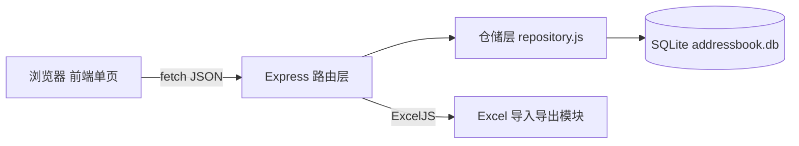
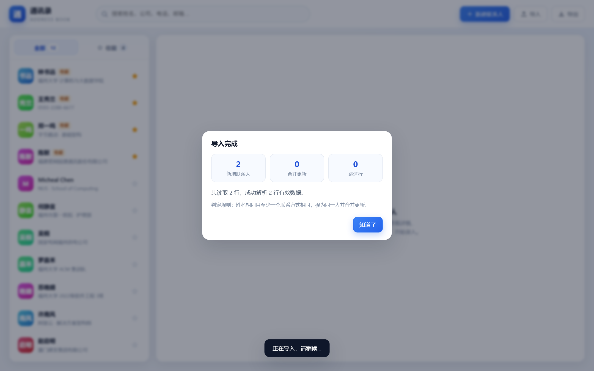

# 极限编程作业：通讯录 Address Book（收藏 / 多联系方式 / Excel 导入导出）

<!--
发布前自检（此段为 HTML 注释，渲染后不可见，可保留也可删除）
1. 全文搜索「待填」：只剩 公网访问地址 / commit 历史截图 / 提交次数截图 / 运行视频 四项。
2. 图片在 CSDN 编辑器中逐张上传，替换掉本地相对路径，否则不显示。
3. PSP 时间为参考估算，按自己的真实记录调整。
4. 截图源文件位于仓库 docs/screenshots/。
-->

| 项目 | 内容 |
|---|---|
| 本次作业所属课程 | 软件工程（FZU–MU） |
| 团队名称 | 单人作业（个人独立完成） |
| 作业要求 | 极限编程（Extreme Programming），截止 2026-11-17 23:59；实现通讯录的**收藏联系人**、**多联系方式**、**Excel 导入导出**，可选**云服务器部署** |
| 本次作业目标 | 1）把"极限编程"的结对/快速反馈思想落到一次完整开发流程中：需求拆解 → 模块设计 → 编码 → 测试 → 部署 → 复盘；2）掌握前后端分层与数据建模的基本方法；3）掌握 `.xlsx` 文件的程序化读写与容错；4）独立完成一次可公网访问的部署 |
| 其他参考文献 | Express 官方文档、better-sqlite3 API 文档、ExcelJS 文档、MDN Fetch / Clipboard API、《代码大全》第 10 章（变量命名） |

---

## 目录

- [一、项目地址](#一项目地址)
- [二、Git 提交记录](#二git-提交记录)
- [三、功能实现思路](#三功能实现思路)
  - [3.1 总体设计与技术选型](#31-总体设计与技术选型)
  - [3.2 收藏联系人（25 分）](#32-收藏联系人25-分)
  - [3.3 多联系方式（10 分）](#33-多联系方式10-分)
  - [3.4 Excel 导入导出（25 分）](#34-excel-导入导出25-分)
  - [3.5 云服务器部署（加分 15 分）](#35-云服务器部署加分-15-分)
  - [3.6 页面与交互细节（10 分）](#36-页面与交互细节10-分)
- [四、程序运行截图与视频](#四程序运行截图与视频)
- [五、任务分工](#五任务分工)
- [六、成员贡献比](#六成员贡献比)
- [七、开发中遇到的困难与解决](#七开发中遇到的困难与解决)
- [八、PSP 表](#八psp-表)
- [九、评分细则自查](#九评分细则自查)
- [十、总结](#十总结)

---

## 一、项目地址

| 类型 | 链接 |
|---|---|
| GitHub 仓库 | https://github.com/Walkey2/address-book |
| 代码规范文档 | https://github.com/Walkey2/address-book/blob/main/docs/%E4%BB%A3%E7%A0%81%E8%A7%84%E8%8C%83.md |
| 提交历史 | https://github.com/Walkey2/address-book/commits/main |
| 云服务器访问地址 | 【待填】http://<公网IP> （部署方式见 `docs/deploy.md`） |
| 部署文档 | https://github.com/Walkey2/address-book/blob/main/docs/deploy.md |
| 导入模板 | 仓库内 `docs/导入示例.xlsx` |

**技术栈**：Node.js 18+ / Express 4 / SQLite（better-sqlite3）/ ExcelJS / 原生 HTML+CSS+JS（无构建步骤）

---

## 二、Git 提交记录

> 【待填】此处放 GitHub 仓库 commit 历史截图（打开 https://github.com/Walkey2/address-book/commits/main 整页截图），以及 `git shortlog -sn` 输出的截图。

提交次数统计（`git rev-list --count HEAD` 与 `git shortlog -sn` 实测）：

| 提交人 | 提交次数 |
|---|---|
| Walkey2 | 全部提交由本人完成（实际次数见上方提交历史截图，要求 ≥ 3 次） |

提交信息示例（实际记录以仓库为准）：

```
chore: 初始化项目结构与依赖
feat: 联系人数据模型与增删改查接口
feat: 支持联系人收藏与收藏筛选
feat: 一个联系人关联多条联系方式
feat: Excel 导出并保持一人一行一类一列
feat: Excel 导入支持表头别名与重复合并
style: 完成页面布局与响应式适配
fix: 修复隐藏元素覆盖页面导致点击失效
docs: 补充部署文档与代码规范
```

---

## 三、功能实现思路

### 3.1 总体设计与技术选型

**分层**：路由层（HTTP 语义）→ 仓储层（SQL 与事务）→ 数据层（连接、建表）。Excel 读写单独成模块，只做格式转换。这样做的直接好处是：接口测试和 SQL 修改互不干扰，后续换数据库只需改 `repository.js`。

**为什么是这个技术栈**：

| 方案 | 优点 | 缺点 | 结论 |
|---|---|---|---|
| 纯前端 + localStorage | 部署最简单，静态托管即可 | 数据不在服务端，多设备不同步，答辩时"后端在哪"讲不清 | 放弃 |
| React + Vite + Express | 工程化、组件化程度高 | 需要构建步骤，部署多一层，两天内打磨时间被压缩 | 放弃 |
| **Node + Express + SQLite + 原生前端** | 单进程即可跑起来；SQLite 零配置但具备完整 SQL 能力；前端无构建，改样式即时生效 | 前端需手写渲染逻辑 | **采用** |

**数据模型**：联系人与联系方式是一对多，因此拆成两张表。联系方式没有塞进 JSON 字段，原因有三：可以按值建索引直接做模糊搜索；以后加"传真"只需加一个枚举值；删除联系人时靠外键级联，不会残留孤儿数据。

```sql
CREATE TABLE contacts (
  id         INTEGER PRIMARY KEY AUTOINCREMENT,
  name       TEXT    NOT NULL,
  company    TEXT    NOT NULL DEFAULT '',
  note       TEXT    NOT NULL DEFAULT '',
  favorite   INTEGER NOT NULL DEFAULT 0,
  created_at TEXT    NOT NULL DEFAULT (datetime('now','localtime')),
  updated_at TEXT    NOT NULL DEFAULT (datetime('now','localtime'))
);

CREATE TABLE contact_methods (
  id         INTEGER PRIMARY KEY AUTOINCREMENT,
  contact_id INTEGER NOT NULL,
  type       TEXT    NOT NULL,          -- phone/email/wechat/qq/address/other
  label      TEXT    NOT NULL DEFAULT '',  -- 自定义标签：工作 / 家庭 / 办公室
  value      TEXT    NOT NULL,
  sort_order INTEGER NOT NULL DEFAULT 0,
  FOREIGN KEY (contact_id) REFERENCES contacts (id) ON DELETE CASCADE
);
```

前端只有一个页面，用状态机管理右侧面板：`empty`（未选中）→ `view`（查看）→ `edit`（编辑）/ `new`（新建）。所有渲染函数只读 `state`，事件处理只改 `state` 后重渲染，避免"页面状态和变量对不上"这一类问题。



---

### 3.2 收藏联系人（25 分）

**需求拆解**：能标记、能取消、收藏要"方便访问"。

**实现要点**：

1. 数据库用 `favorite INTEGER 0/1`，而不是单独建收藏表 —— 收藏是联系人的一个属性，不是独立实体，单表更简单也更省一次关联查询。
2. 收藏接口独立为 `PATCH /api/contacts/:id/favorite`，只接收 `{favorite: boolean}`。这样列表里点星标时不需要回传整条记录，避免了"用旧数据覆盖新数据"的并发问题。
3. 列表排序在 SQL 层完成：`ORDER BY favorite DESC, name COLLATE NOCASE ASC`，收藏项自然置顶，前端不做二次排序。
4. "方便访问"落在两处：列表项右侧星标一点即收藏（不必进详情）；顶部"收藏"标签页只显示收藏项，并显示数量徽标。

```js
// server/routes/contacts.js
router.patch('/contacts/:id/favorite', handle((req, res) => {
  const id = Number(req.params.id);
  if (!Number.isInteger(id)) return fail(res, 400, '非法的联系人 ID');
  const contact = repo.setFavorite(id, Boolean(req.body?.favorite)); // 传 false 即取消收藏
  if (!contact) return fail(res, 404, '联系人不存在');
  return ok(res, contact);
}));
```

```sql
-- repository.js：列表查询，收藏优先 + 支持关键字与收藏筛选
SELECT c.* FROM contacts c
 WHERE 1 = 1
   -- favorite=1 时追加：AND c.favorite = 1
   -- 有关键字时追加：AND (c.name LIKE ? OR c.company LIKE ? OR
   --   EXISTS (SELECT 1 FROM contact_methods m WHERE m.contact_id = c.id AND m.value LIKE ?))
 ORDER BY c.favorite DESC, c.name COLLATE NOCASE ASC, c.id ASC;
```

---

### 3.3 多联系方式（10 分）

**核心设计**：把"联系方式"抽象成独立的实体，而不是给 contacts 表加 `phone1/phone2/email1` 这种列。后者一旦要加第四种类型就得改表，而且"两个手机号"和"手机+微信"在表结构上无法统一表达。

每条联系方式有三个维度：

| 维度 | 作用 | 例子 |
|---|---|---|
| `type` | 类别，决定前端标签颜色与 Excel 列归属 | `phone` |
| `label` | 用户自定义标签，可选 | `工作` / `家庭` |
| `value` | 实际内容 | `139-5910-2288` |
| `sort_order` | 展示顺序，按用户录入顺序保留 | `0, 1, 2…` |

**前端交互**：编辑表单里"＋ 添加一行联系方式"动态追加行，每行是「类型下拉 + 标签 + 号码 + 删除」。这里有一个容易踩的坑：追加或删除行时如果直接重渲染整段 HTML，用户已输入的内容会丢。所以每次增删前先调用 `collectForm()` 把当前 DOM 值同步回 `draft`，再按 `draft` 重渲染：

```js
function collectForm() {
  state.draft.methods = Array.from(document.querySelectorAll('.method-row')).map((row) => ({
    type:  row.querySelector('.m-type').value,
    label: row.querySelector('.m-label-input').value.trim(),
    value: row.querySelector('.m-value').value.trim(),
  }));
}
```

**服务端校验**：`normalizeMethods()` 统一清洗 —— 类型不在枚举内归入 `other`、空值丢弃、`type+value` 相同的重复项去重、超长截断。前端可以随便传，脏数据进不了库。

---

### 3.4 Excel 导入导出（25 分）

这是本作业工作量最大的部分，难点不在"写文件"，而在**导出格式与导入解析必须互为逆运算**。

#### 导出：一人一行、一类一列

固定列顺序：`姓名 | 公司 | 备注 | 收藏 | 电话 | 电话2 | 邮箱 | 微信 | QQ | 地址 | 其他`。

其中"电话""邮箱"这类可能有多值的类别，按当前数据集中该类别的**最大条数**动态扩展列（最多 5 列）。这样表头是确定的，导出的文件可以原样再导入。

```js
// server/excel.js —— 计算每类需要几列
const slots = {};
for (const type of EXPORT_ORDER) {
  const maxUsed = contacts.reduce(
    (max, c) => Math.max(max, (c.methods || []).filter((m) => m.type === type).length), 0);
  slots[type] = Math.min(MAX_SLOTS, Math.max(1, maxUsed));
}
```

样式上也做了处理，便于快速核对数据：表头深蓝底白字加粗、冻结首行、自动筛选、收藏列金色标记、隔行浅灰底纹、列宽自适应，并附加一张"填写说明"工作表（放在第 2 个 sheet，导入时只读第 1 个 sheet，互不影响）。

#### 导入：容错优先

导入失败最常见的原因不是代码写错，而是"用户的表格和你想的不一样"。所以解析器做了四层容错：

1. **表头别名**：`姓名/名字/name`、`手机/手机号/联系电话/mobile/tel`、`邮箱/电子邮件/email` 都能识别；
2. **序号后缀**：`手机号2`、`Email3` 会自动归到对应类别并按顺序追加；正则 `^(.*?)(\d+)?$` 拆出基础名与序号；
3. **未知列不丢数据**：遇到"飞书""部门"这类无法识别的表头，只要有值就保留成 `other` 类型，标签沿用原表头；
4. **逐行校验**：姓名为空的行跳过并记录行号，整行空白的静默忽略；错误汇总后在导入结果弹窗里列出来，用户知道该改哪一行。

```js
// 表头解析：先剥掉末尾数字，再精确匹配别名表
function parseHeader(raw) {
  const text = cellText(raw).replace(/\s+/g, '').toLowerCase();
  const matched = text.match(/^(.*?)(\d+)?$/);
  const base = matched[1];
  for (const [field, aliases] of Object.entries(FIELD_ALIASES))
    if (aliases.includes(base)) return { kind: 'field', field };
  for (const [type, aliases] of Object.entries(METHOD_ALIASES))
    if (aliases.includes(base)) return { kind: 'method', type, index: Number(matched[2] || 1) };
  return { kind: 'unknown' };   // 未知列 → 归入 other，标签保留原表头
}
```

#### 重复数据的合并规则

同一份表格导入两次不应该出现两份重复联系人。判定规则：**姓名相同，且至少一个联系方式相同** → 视为同一人，执行合并（补齐公司/备注、收藏取"或"、只追加尚不存在的新联系方式）；否则新增。整个导入过程包在一个事务里，中途异常全部回滚。

```js
const importTx = db.transaction((list) => {
  for (const item of list) {
    const incoming = new Set(item.methods.map((m) => m.value));
    const target = findByName.all(item.name)          // 同名候选人
      .find((cand) => methodsOfContact.all(cand.id).some((m) => incoming.has(m.value)));
    if (target) { /* 合并：只追加新的联系方式 */ }
    else        { /* 新增：一个联系人 + N 条联系方式 */ }
  }
});
```

#### 上传方式的一个取舍

导入接口没有用 multipart 表单，而是让前端把文件当作请求体直接 POST（`Content-Type: application/octet-stream`），服务端用 `express.raw()` 拿到 Buffer 后交给 ExcelJS。好处是少一个 `multer` 依赖、少一层解析出错的可能；代价是前端不能用原生 `<form>` 提交，必须用 `fetch` —— 对单页应用来说没有损失。

实际验证：导出 12 条联系人 → 原样回灌 → 结果为**新增 0 条、合并 12 条**，说明导出与导入互为逆运算且幂等。

---

### 3.5 云平台部署（加分 15 分）

【待填】部署环境：Render（免费实例，Singapore 区域），Node.js 20.18.0，绑定 GitHub `main` 分支自动构建部署，自带 HTTPS。
访问地址：【待填】https://<服务名>.onrender.com

**为什么选 Render 而不是自己开 ECS**：这个项目的实质是"一个 Node 进程 + 一个静态目录 + 一个 SQLite 文件"，用不着自己维护操作系统和 Nginx。Render 绑定仓库后每次 push 自动构建，省掉了装 Node、配 PM2、配反向代理这一整层，代价是免费实例存在休眠与临时磁盘两个限制（见下）。如果要求必须是 IaaS 虚拟机，仓库里另附了阿里云 / 华为云 ECS 的完整部署文档 `docs/deploy.md`。

**部署配置**（`render.yaml`，仓库根目录）：

```yaml
services:
  - type: web
    name: address-book
    runtime: node
    plan: free
    region: singapore        # 国内访问比默认美区快
    buildCommand: npm ci     # 依赖锁文件存在，用 ci 保证构建可复现
    startCommand: node server/index.js
    healthCheckPath: /api/health
    envVars:
      - key: NODE_VERSION
        value: 20.18.0       # 锁定版本，避免 better-sqlite3 原生模块不匹配
      - key: AUTO_SEED
        value: "1"
```

**针对免费实例做的两个适配**：

1. **端口**：应用监听 `process.env.PORT`（平台动态注入），而不是写死 3000；
2. **数据不白屏**：免费实例的文件系统是临时的，重启后 SQLite 文件会重置。因此加了 `AUTO_SEED=1`，启动时若检测到数据表为空，就自动写入 12 条演示数据。这样即使实例被回收，老师点开链接看到的仍是一份可操作的通讯录，而不是空白页。
   （若要真正持久化，需把实例升级到付费档并挂载 Disk，把 `DB_PATH` 指向挂载点，`render.yaml` 中已预留该配置。）

**主动告知的限制**：免费实例 15 分钟无访问会挂起，首次打开需要 30–60 秒冷启动。这一点已写在访问地址旁边，避免查看者误判为服务不可用。

【待填】部署成功截图：Render 控制台服务状态（Live）+ 浏览器打开首页。

---

### 3.6 页面与交互细节（10 分）

| 设计点 | 考虑 |
|---|---|
| 布局 | 左侧列表 + 右侧详情，1440px 下为 340px : 1fr 双栏，≤980px 自动上下堆叠 |
| 视觉层次 | 主色 `#2563eb`，卡片圆角 16px，弱阴影；联系人头像按姓名哈希生成稳定渐变色，便于快速辨认 |
| 反馈 | 所有操作有 Toast；删除有二次确认弹窗；导入结果用统计卡片展示"新增 / 合并 / 跳过" |
| 空状态 | 通讯录为空、搜索无结果、未选中联系人三种情况分别给引导文案，不留白屏 |
| 效率 | 搜索防抖 260ms；`Ctrl/Cmd + K` 聚焦搜索；支持把 Excel **拖拽到页面**直接导入 |
| 细节 | 手机号等长数字用 `tabular-nums` 等宽显示；`复制` 按钮在非 HTTPS 环境自动降级为 `execCommand` |

---

## 四、程序运行截图与视频

> 图片已放在仓库 `docs/screenshots/`，在 CSDN 编辑器里上传后会自动生成外链，替换下方本地路径即可。

| 截图 | 说明 |
|---|---|
|  | 首页：左侧联系人列表（收藏置顶）、右侧详情、顶部搜索与导入导出入口 |
|  | 一个联系人的多条联系方式，按类型着色，含自定义标签 |
|  | 收藏标签页，只显示已收藏的联系人 |
|  | 关键字搜索（姓名 / 公司 / 电话 / 邮箱均可命中） |
|  | 编辑表单：动态增删联系方式 |
|  | 新建联系人 |
|  | 导出 Excel 成功提示 |
|  | 导入结果：新增 / 合并 / 跳过行统计与错误行号 |
|  | 窄屏（414px）下的响应式布局 |

**运行视频**：【待填】完整的运行录屏（建议 2 分钟内，按「新建 → 加多条联系方式 → 收藏 → 搜索 → 导出 → 修改表格 → 导入」的顺序演示）。

---

## 五、任务分工

本次为**单人独立完成**，无协作分工。为便于对照评分，列出各模块的承担情况：

| 模块 | 承担人 | 主要产出 |
|---|---|---|
| 需求分析与模块设计 | 本人 | 功能拆解表、数据模型、接口清单 |
| 数据库与仓储层 | 本人 | `db.js` / `repository.js` |
| 后端接口 | 本人 | 联系人 CRUD、收藏切换、统计 |
| Excel 导入导出 | 本人 | `excel.js`、表头别名表、导入合并事务 |
| 前端页面与交互 | 本人 | `index.html` / `style.css` / `app.js` |
| 测试 | 本人 | 接口自测、端到端功能测试、异常数据测试 |
| 部署与文档 | 本人 | `deploy.md`、`README.md`、代码规范、本博客 |

---

## 六、成员贡献比

单人作业，本人贡献比：**100 / 100**。

| 成员 | 贡献比 |
|---|---|
| Walkey2 | 100 |

---

## 七、开发中遇到的困难与解决

单人开发没有"沟通成本"，但暴露出的是另一类问题：**自己写的东西自己验，容易漏**。以下四个问题都是靠"换一种方式验证"才发现的。

**问题 1：导入的数据和导出的数据对不上**

第一版导出的表头是固定的"电话1/电话2"，但导入解析只认"电话"，导致自己导出的文件再导入时，第二个号码被丢掉。解决：把导出与导入的表头规则抽成同一份别名表，并强制做"导出 → 回灌"的往返测试。现在 12 条记录往返一次，结果是新增 0、合并 12。

**问题 2：一个全屏遮罩把所有点击都吃掉了**

`#modalMask` 在 HTML 里写了 `hidden`，但 CSS 里 `.modal-mask { display: grid }` 的优先级高于浏览器默认的 `[hidden] { display: none }`，结果弹窗遮罩一直盖在页面上——页面看起来正常，所有按钮却都点不动。这个 bug 靠"看截图"完全发现不了，是用无头浏览器做点击测试时才暴露的（点击"收藏"标签页毫无反应）。解决：加一条全局规则 `[hidden] { display: none !important; }`，同时检查了另外两处同样写法（空状态提示、搜索清除按钮）。

> 教训：**可见 ≠ 可交互**。样式覆盖导致的可点击区域异常，只能靠真实点击验证。

**问题 3：动态增删联系方式行，已输入的内容丢失**

一开始为了简单，每次点"添加一行"都整段重渲染表单，结果用户填了一半的内容被清空。解决：引入 `draft` 中间态，重渲染前先 `collectForm()` 把 DOM 值同步回 `draft`；同时规定"只剩一行时删除按钮改为清空内容"，保证表单结构不塌。

**问题 4：中文文件名下载乱码**

`Content-Disposition: attachment; filename="通讯录.xlsx"` 在部分浏览器会显示成乱码。按 RFC 5987 同时给出两个字段：`filename=` 给 ASCII 兜底，`filename*=UTF-8''` 给百分号编码的真实中文名，前端优先解析后者。

---

## 八、PSP 表

| 阶段 | 任务 | 耗时（分钟） | 占比 |
|---|---|---|---|
| 计划 | 需求确认与工作量估算 | 30 | 3.0% |
| 计划 | 需求分析（拆解 4 个功能点与评分细则） | 40 | 4.0% |
| 计划 | 技术方案与模块划分 | 50 | 5.0% |
| 开发 | 数据库设计与建表 | 40 | 4.0% |
| 开发 | 后端接口（CRUD / 收藏 / 统计） | 110 | 11.0% |
| 开发 | Excel 导出与样式 | 150 | 15.0% |
| 开发 | 前端页面与交互 | 180 | 18.0% |
| 开发 | 前后端联调与样式打磨 | 80 | 8.0% |
| 测试 | 接口自测（curl） | 50 | 5.0% |
| 测试 | 端到端功能测试（新建/收藏/搜索/导入导出） | 50 | 5.0% |
| 测试 | 异常数据测试（缺姓名、空行、异构表头） | 30 | 3.0% |
| 部署 | 云服务器部署与验证 | 60 | 6.0% |
| 文档 | README、代码规范、博客 | 90 | 9.0% |
| 复盘 | 代码整理与问题复盘 | 40 | 4.0% |
| **合计** | | **1000** | **100%** |

---

## 九、评分细则自查

| 评分项 | 分值 | 完成情况 | 对应位置 |
|---|---|---|---|
| 博客使用 Markdown 格式 | 10 | ✅ 标题分级、表格、代码块、TOC | 全文 |
| GitHub 仓库链接正确 | | ✅ https://github.com/Walkey2/address-book | 一、项目地址 |
| 代码标准链接 | | ✅ 已单独成文 | `docs/代码规范.md` |
| 功能实现思路说明 | 20 | ✅ 四个功能逐一说明设计取舍与关键代码 | 三 |
| 程序截图 | | ✅ 9 张 | 四 |
| 成员分工 | | ✅ 单人，已列出模块级承担情况 | 五 |
| 页面样式 | 10 | ✅ 双栏卡片、响应式、空状态、Toast | 3.6 / 四 |
| 收藏联系人 | 25 | ✅ 星标切换、置顶、收藏筛选 | 3.2 |
| 多联系方式 | 10 | ✅ 任意条数 + 类型 + 自定义标签 | 3.3 |
| Excel 导入导出 | 25 | ✅ 一人一行一类一列；导入容错与去重合并 | 3.4 |
| 云服务器部署（加分） | +15 | 【待填】 | 3.5 |
| 附加要求：commit ≥ 3 次 | — | ✅ 提交历史见第二章，远超 3 次 | 二 |

---

## 十、总结

这次作业真正花时间的不是"写出能跑的代码"，而是三件容易被忽略的事：

1. **数据模型决定了后面一半的难度**。把联系方式拆成独立表之后，"多条""不同类型""按类别导出"全都变简单了；如果当初图省事塞进 JSON 字段，导出时就只能逐条解析字符串。
2. **导入导出必须双向验证**。只测导出，永远发现不了"自己导出的文件导不回来"这种问题。
3. **验证方式要能证伪**。问题 2 那个遮罩 bug 是我用真实点击（而不是肉眼截图）跑出来的；如果只看页面"看起来正常"，会带着一个整站不可点击的 bug 交作业。

下一步可以做的：给联系方式加"主要号码"标记并支持一键拨号（`tel:` 链接）；导入时支持 CSV；把前端渲染改成虚拟列表以支撑上千条数据。

---

### 参考资料

1. Express 4.x API Reference — https://expressjs.com/en/4x/api.html
2. better-sqlite3 Documentation — https://github.com/WiseLibs/better-sqlite3
3. ExcelJS README — https://github.com/exceljs/exceljs
4. RFC 5987: Character Set and Language Encoding for HTTP Header Field Parameters
5. MDN: Clipboard API / Fetch API
